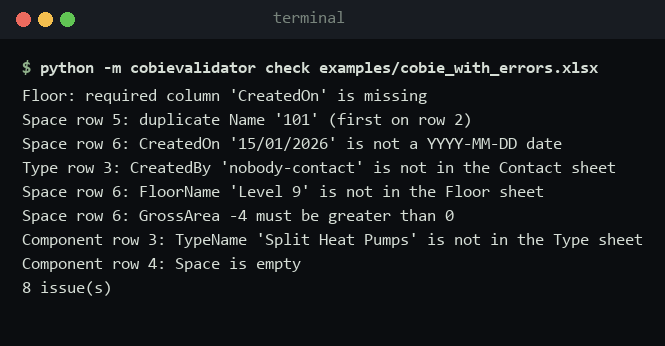

# cobie-spreadsheet-validator

COBie is the spreadsheet format used to hand a finished building over to its operators. A handover that points to a space or type that does not exist is hard to load into a maintenance system. This tool reads a COBie workbook and lists every missing sheet or column, broken reference, duplicate name and bad value.



## What it is for

Facility managers, commissioning agents and project engineers receive COBie workbooks at handover and need to know quickly whether they are usable. Run this check before the data is accepted or imported, and send the contractor the exact rows to fix.

## Install

```
git clone https://github.com/yassine2med/cobie-spreadsheet-validator
cd cobie-spreadsheet-validator && pip install -r requirements.txt
```

## How to use

| I want to | Command |
|---|---|
| Check a workbook and list every issue | `PYTHONPATH=src python -m cobievalidator check examples/cobie_with_errors.xlsx` |
| Check a clean workbook (prints "0 issue(s)", exit code 0) | `PYTHONPATH=src python -m cobievalidator check examples/cobie_valid.xlsx` |
| Show each sheet with its row count | `PYTHONPATH=src python -m cobievalidator sheets examples/cobie_valid.xlsx` |
| Show help | `PYTHONPATH=src python -m cobievalidator --help` |

Example:

```
PYTHONPATH=src python -m cobievalidator check examples/cobie_with_errors.xlsx
```

Output:

```
Floor: required column 'CreatedOn' is missing
Space row 5: duplicate Name '101' (first on row 2)
Space row 6: CreatedOn '15/01/2026' is not a YYYY-MM-DD date
Type row 3: CreatedBy 'nobody-contact' is not in the Contact sheet
Space row 6: FloorName 'Level 9' is not in the Floor sheet
Space row 6: GrossArea -4 must be greater than 0
Component row 3: TypeName 'Split Heat Pumps' is not in the Type sheet
Component row 4: Space is empty
8 issue(s)
```

Run the tests with `python -m pytest -q`.

## How it works

1. The workbook is opened with `openpyxl` and each sheet is read as a header row plus data rows. Blank rows are skipped.
2. Required sheets and columns are checked: Contact, Facility, Floor, Space, Type and Component.
3. Names must be unique in each sheet (case does not matter). Contacts are identified by email.
4. References are checked: Space.FloorName must exist in Floor, Component.TypeName in Type, Component.Space in Space, and CreatedBy in Contact.
5. Values are checked: CreatedOn and InstallationDate must be YYYY-MM-DD dates, and GrossArea must be a number above 0.
6. `examples/make_samples.py` rebuilds the two sample workbooks. All sample data is invented.

## Limits

- Covers the six core COBie sheets only (not Zone, System, Job, Spare and the rest).
- Checks structure and references, not whether the data is true.
- xlsx input only. Exit code 1 means issues were found, 2 means the file could not be read.

## License

MIT. Yassine Emhamed, 2026.
